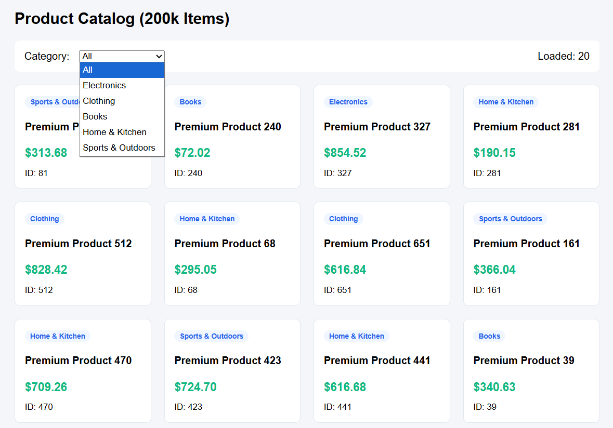

# Product Browser API

A backend project built for the CodeVector internship take-home task. This API allows users to browse around 200,000 products, filter products by category, search by product name, and paginate through results efficiently using cursor-based pagination and Redis caching.

## Live Demo

Live URL: https://product-browser-api-1-zf52.onrender.com

Test API: https://product-browser-api-1-zf52.onrender.com/api/products?limit=20

## GitHub Repository

GitHub Repo: https://github.com/shipra830/product-browser-api

## Project Screenshot

## Tech Stack

- Node.js & Express.js
- PostgreSQL (Neon Database)
- Redis (Upstash) for Caching
- Render (Deployment)
- HTML, CSS, JavaScript for simple UI

## Features

- **Redis Caching:** Integrated for millisecond response times on frequent queries.
- **Full-Text Search (FTS):** PostgreSQL GIN indexing for highly optimized product name searches.
- Browse 200,000 products with newest-first listing.
- Category-based filtering.
- Fast cursor-based pagination (stable while data is changing).
- Batch seed script for generating products.

## API Endpoint

### Get Products

GET /api/products

### Query Parameters

| Parameter | Required | Description                                                            |
| --------- | -------- | ---------------------------------------------------------------------- |
| limit     | No       | Number of products to return. Default is 20. Maximum is capped at 100. |
| category  | No       | Filter products by category.                                           |
| search    | No       | Search products by name using Full-Text Search.                        |
| cursor    | No       | Cursor returned from the previous response for loading the next page.  |

## Example Requests

/api/products?limit=20

/api/products?limit=20&category=Electronics

/api/products?limit=20&category=Books&cursor=cursor_value_here

## Example Response

{
  "success": true,
  "count": 20,
  "nextCursor": "2026-06-23T10:20:30.000Z_150_2026-06-23T12:00:00.000Z",
  "products": [
    {
      "id": 150,
      "name": "Premium Product 150",
      "category": "Electronics",
      "price": "299.99",
      "created_at": "2026-06-23T10:00:00.000Z",
      "updated_at": "2026-06-23T10:20:30.000Z"
    }
  ]
}

## Pagination Strategy

I used cursor-based pagination instead of offset-based pagination. Offset-based pagination can become slow on large datasets because the database has to skip many rows before returning the requested results. It can also become inconsistent when new products are inserted or existing products are updated while a user is browsing.

The API sorts products by: `updated_at DESC, id DESC`

The cursor contains:
- The last product's updated_at
- The last product's id
- A stable snapshotTime

When the first page is requested, the API creates a snapshot timestamp. All next pages use the same snapshot timestamp. This means newly added or updated products do not change the current browsing order, which helps prevent duplicate or missed products during pagination.

## Database Indexes

The following indexes are used for better query performance and rapid searching:

CREATE INDEX idx_products_updated_id ON products (updated_at DESC, id DESC);
CREATE INDEX idx_products_category_updated_id ON products (category, updated_at DESC, id DESC);
CREATE INDEX IF NOT EXISTS idx_products_name_fts ON products USING GIN (to_tsvector('english', name));

## Seeding

The database is populated with 200,000 products using a seed script. The seed script inserts products in batches instead of inserting one product at a time, making the process much faster.

Run seed:
npm run seed

## Run Locally

Install dependencies:
npm install

Create a .env file:
DATABASE_URL=your_neon_postgresql_url
REDIS_URL=your_upstash_redis_url
PORT=10000

Start the server:
npm start

For development:
npm run dev

Open in browser:
http://localhost:10000

Test API:
http://localhost:10000/api/products?limit=20

## Project Structure

product-browser-api/
│
├── screenshots/
│   └── product-browser-api.png
├── index.html
├── server.js
├── seed.js
├── schema.sql
├── package.json
├── package-lock.json
├── README.md
└── .gitignore

Note: The .env file is not included in the repository for security reasons.

## What I Chose and Why

I chose Node.js with Express.js because it is simple and suitable for REST APIs. I used PostgreSQL with Neon because it supports efficient indexing, Full-Text Search, and reliable pagination. Redis (via Upstash) was integrated to cache frequent database queries, drastically reducing load times and database bandwidth. Cursor-based pagination was chosen over offset-based pagination for its superior performance and consistency on large datasets.

## What I Would Improve With More Time

With more time, I would add:
- Automated tests for pagination and filtering
- Better API documentation (Swagger)
- More detailed error handling
- Query performance benchmarking
- Monitoring and logging
- A production-ready bulk insert method using PostgreSQL COPY

## How I Used AI

I used AI to understand the best pagination approach for changing data, optimize PostgreSQL query structures with GIN indexes, and integrate Redis caching. AI also helped with code review, README drafting, and identifying why offset-based pagination is not ideal for this task. I reviewed the generated suggestions myself and ensured I understood the cursor-based logic and cache invalidation strategies.